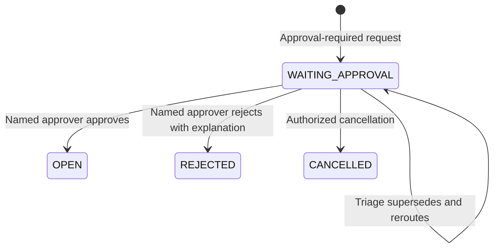

# Step 8: Service request approvals

The backend now supports one named supervisor per approval round. This guide
supplements [Steps 6 and 7](OPERATIONS.md); approval-required creation and
cancellation are no longer blocked as an unavailable module. `plan.md` contains
the proposed module tree, so the detailed approval rules in the implementation
request supply the behavior for this stage.

## Endpoints and permissions

| Endpoint | Access and behavior |
| --- | --- |
| `GET /api/v1/approvals` | Current named eligible supervisor; defaults to actionable `PENDING` rounds. Other users receive an empty inbox. |
| `POST /api/v1/approvals/:approvalId/decision` | Current named eligible approver; accepts `decision`, `expectedVersion`, optional bounded `decisionNote`. Rejection requires a note. |
| `POST /api/v1/tickets/:ticketId/approval-reroutes` | Current `ticket_triage` supervisor covering the original department; requires `approverId`, `expectedVersion`, and `reason`. |
| `GET /api/v1/tickets/:ticketId/approvals` | Requester and current triage see rounds; eligible named supervisors see their own historical rounds. Support or administrator status alone grants no history access. |
| `POST /api/v1/tickets` | Existing submission contract and idempotency; service catalog controls the frozen approval requirement. |

`GET /approvals` supports `status=PENDING|APPROVED|REJECTED|SUPERSEDED`, ISO
timestamps with timezone in `from`/`to` (inclusive **requestedAt** bounds),
`sort=requestedAt|-requestedAt|decidedAt|-decidedAt`, `page` and `limit` (maximum
100). Default sort is `-requestedAt`. Organization, current scope, named
approver, requester exclusion and pending-round checks precede pagination and
counts. The history endpoint accepts `page` and `limit`.

Approval responses contain an allowlist of public ticket context and approval
decisions. They do not load discussions, worklogs, attachments, assets, financial
data or custody. Decision notes are visible in authorized approval history,
including the requester's own history; do not use them for internal technician
notes. Reroute reasons appear only in triage approval history and internal ticket
events. Outbox payloads contain identifiers, never decision notes or previews.

## Configuration and migration

Use a MongoDB replica set. Keep the existing opaque session, CSRF secret, allowed
origin and cookie configuration; Step 8 adds no runtime dependencies or required
environment variables. See `.env.example` for existing settings.

Configure these database records using your controlled provisioning process:

- `Department.designatedApprover`: the primary supervisor. The existing model
  requires this user to belong to that department and organization.
- `Organization.backupApprover`: explicitly configured backup user ID, nullable;
  it must belong to the organization. It may belong to another department, but
  must hold a qualifying scope covering the requesting department.
- Both candidates must currently be active `SUPERVISOR` accounts with active
  `department_supervise` or `ticket_triage` scope covering the original requester
  department, and cannot be the requester. Organization-wide grants also qualify.
- An active `REQUEST` service item with `requiresApproval: true`, an active SLA
  policy and business calendar. Incidents cannot require approval.

Missing, inactive, self, foreign or out-of-scope primaries cause selection of the
configured eligible backup. There is no arbitrary supervisor fallback. If neither
qualifies, submission returns **409 `APPROVER_CONFIGURATION_REQUIRED`** and writes
no ticket, counter increment, approval, cycle, history, audit or outbox record.
After fixing configuration, retry the original submission body and key.
Configuration changes affect future submissions; pending rounds require explicit
rerouting. There is no new organization/catalog settings HTTP API in this stage.

From `backend`, after setting `MONGODB_URI` to the target replica set:

```powershell
npm run db:indexes
```

The additive migration imports the approval model and creates the actual indexes:

| Index | Constraint |
| --- | --- |
| `approval_ticket_round_unique` | Unique `(organization, ticket, round)` |
| `approval_one_pending_per_ticket` | Unique `(organization, ticket)` where `status: PENDING` |
| `approval_inbox` | `(organization, approver, status, requestedAt)` lookup |

It also backfills `currentApprovalRound: 0` only on old non-approval tickets.
It never invents decisions for imported approval-required tickets or overwrites
snapshots, SLA starts or prior rounds. Malformed imported approval tickets stay
blocked until their historical data is deliberately repaired. Existing duplicate
approval data will make index creation fail; investigate it rather than dropping
the unique indexes. No collections/indexes are dropped by the migration.

## Transitions, concurrency and clocks



Each decision or reroute requires the **ticket** `expectedVersion`, not an approval
document version. Mutations increment that version inside the transaction.
Simultaneous decision/reroute/cancel commands using the same version produce one
valid winner and 409 conflicts. `Idempotency-Key` is required for submission,
decisions and reroutes; reuse the identical body and key when retrying a lost
response. Different input with the same scoped key is rejected. Successful replay
includes `Idempotency-Replayed: true`, reauthorizes current access and serializes
current state. Existing idempotency retention is 24 hours.

The shared ticket-command gate checks the persisted **current APPROVED round**
before triage, claim, assignment, start, wait, resume, worklog, resolution, reopening
and a waiting-requester reply that resumes work. Catalog changes and a ticket's
approval-status flag alone cannot authorize fulfillment. Approved tickets enter
the ordinary OPEN queue; approval performs no asset assignment or provisioning.

WAITING_APPROVAL creates a resolution-only pause starting at submission. The
response clock continues. Rerouting leaves this pause and cycle intact. Approval
ends the pause without resetting clocks; approval/decision notes are not support
responses. Rejection ends the cycle with `endReason: REJECTED` and exposes
`resolutionTargetEligible: false`. Cancellation supersedes the pending round and
ends its pause/cycle in the same transaction. Prior rounds/cycles remain intact.
The existing resolved-ticket reopening rules apply after approval; reopening
creates an SLA cycle without silently requiring or granting a new approval.
CLOSED, REJECTED and CANCELLED remain terminal. Automatic closure stays disabled.

## Isolated replica-set setup and synthetic data

The repository's test helpers use a dedicated local replica named `step67` on
port 27019; the name is retained for compatibility. Do not point test commands at
an operational database. From the repository root, start MongoDB in a dedicated
terminal (adjust the installed binary path if necessary):

```powershell
New-Item -ItemType Directory -Force .tmp/mongo-step67 | Out-Null
& 'C:\Program Files\MongoDB\Server\9.0\bin\mongod.exe' `
  --dbpath .tmp/mongo-step67 --port 27019 --bind_ip 127.0.0.1 `
  --replSet step67 --logpath .tmp/mongo-step67/mongod.log
```

From another terminal, in `backend`:

```powershell
node scripts/init-test-replica.js
$env:TEST_MONGODB_URI = 'mongodb://127.0.0.1:27019/it_help_desk_test?replicaSet=step67'
npm test

$env:MONGODB_URI = 'mongodb://127.0.0.1:27019/it_help_desk_demo_step8?replicaSet=step67'
$env:DEMO_PASSWORD = 'Choose-a-unique-demo-password!'
npm run seed:approvals
npm run db:indexes
npm start
```

The seed refuses any database other than `it_help_desk_demo_step8`. It is repeatable
and prints IDs. Repeating it does not reset passwords or restore modified grants.
It creates synthetic `employee`, `primary`, `backup`, `triage`, `technician`,
`admin` and `other` accounts at `@approvals.example`. The `other` employee belongs
to an unconfigured department outside the backup's scope, to demonstrate a safe
configuration failure. All accounts use the supplied demo password.

## PowerShell requests with cookie jars and CSRF

The complete runnable [PowerShell walkthrough](examples/approvals.ps1) creates a
separate cookie jar/CSRF token for each actor and demonstrates submission, an
idempotent submission retry, listing, approval, rejection, rerouting, eligible
fallback and fallback failure. It works with Windows PowerShell 5.1:

```powershell
# In backend, while the API is running against the synthetic Step 8 database:
.\examples\approvals.ps1 `
  -ServiceItemId '<serviceItemId printed by seed>' `
  -BackupApproverId '<backupApproverId printed by seed>' `
  -Password 'Choose-a-unique-demo-password!'
```

Use `-Base` and `-Origin` if running on another approved origin/port. The script
uses the following request shape; `$Actor.Cookies` holds the opaque session cookie
returned by login, and `$Actor.Csrf` is `data.csrfToken` from that same login:

```powershell
$key = [guid]::NewGuid().ToString()
Invoke-RestMethod "$Base/approvals/$ApprovalId/decision" -Method Post `
  -WebSession $Actor.Cookies -ContentType 'application/json' `
  -Headers @{ Origin = $Origin; 'X-CSRF-Token' = $Actor.Csrf; 'Idempotency-Key' = $key } `
  -Body (@{ decision = 'APPROVED'; expectedVersion = $TicketVersion } | ConvertTo-Json)
```

No bearer token is used. On a stale-version 409, refresh the ticket/approval,
review the current state, and submit a new command with a new key. An exact retry
of an uncertain prior command keeps the original body, version and key.

## Postman requests

Set `base=http://127.0.0.1:5000/api/v1`, `origin=http://127.0.0.1:5000`,
`serviceItemId`, `backupApproverId`, and `demoPassword` from the setup above.
Enable Postman's cookie jar. Log in again when switching actors; each login
replaces the cookie for this host. Keep each CSRF token with its matching cookie.

Login: `POST {{base}}/auth/login`, header `Origin: {{origin}}`, raw JSON:

```json
{ "email": "employee@approvals.example", "password": "{{demoPassword}}" }
```

After-response script:

```javascript
pm.environment.set("csrf", pm.response.json().data.csrfToken);
```

Every command below uses headers `Origin: {{origin}}`, `Content-Type:
application/json`, `X-CSRF-Token: {{csrf}}`, `Idempotency-Key: {{commandKey}}`.
Set a fresh UUID `commandKey` for each new command; keep it for an exact retry.
Postman supplies the session cookie from its jar. GETs only need the cookie and
Origin. Versions below must be JSON numbers, not quoted strings.

1. **Submit as employee**: `POST {{base}}/tickets`:

   ```json
   { "serviceItemId": "{{serviceItemId}}", "title": "Service access request", "description": "Please enable the selected service for my documented work task.", "urgency": "MEDIUM" }
   ```

   Save `data.ticket.id` as `ticketId`; expect 201, WAITING_APPROVAL, version 0.

2. **List as primary** (log in as `primary@approvals.example`):
   `GET {{base}}/approvals?status=PENDING&sort=-requestedAt&limit=25`.
   Select the row whose `ticket.id` matches `ticketId`; save its `id` as
   `approvalId` and `ticket.version` as `ticketVersion`. Scope filtering precedes
   the returned pagination total.

3. **Approve as primary**: `POST {{base}}/approvals/{{approvalId}}/decision`:

   ```json
   { "decision": "APPROVED", "expectedVersion": {{ticketVersion}}, "decisionNote": "Approved for the stated work task." }
   ```

   Expect 200 with `data.approval.ticket.status: OPEN` and incremented version.

4. **Reject a separate pending request as primary**: create and list another
   request first, then POST to its decision endpoint:

   ```json
   { "decision": "REJECTED", "expectedVersion": {{ticketVersion}}, "decisionNote": "This service is outside the approved duties." }
   ```

   Expect 200 with REJECTED. A blank/missing note returns 400.

5. **Reroute a separate pending request as triage** (log in as
   `triage@approvals.example`): `POST {{base}}/tickets/{{ticketId}}/approval-reroutes`:

   ```json
   { "approverId": "{{backupApproverId}}", "expectedVersion": {{ticketVersion}}, "reason": "Primary approver is unavailable." }
   ```

   Save the returned approval ID and ticket version. Log in as backup, list its
   inbox and decide that new round. The old primary cannot decide its superseded
   round. Requester or triage can GET `{{base}}/tickets/{{ticketId}}/approvals` to
   see both rounds; requester history omits the internal reroute reason.

6. **Eligible fallback**: log in as primary and submit their own request with the
   same submission shape and a fresh key. Self-approval is excluded, so the new
   pending approval appears in the configured backup's inbox.

7. **Fallback failure**: log in as `other@approvals.example` and submit the same
   service item. Expect 409 `APPROVER_CONFIGURATION_REQUIRED`; no ticket is
   created. An administrator's role alone cannot approve it. Fix the department
   primary/backup coverage through controlled configuration, then retry with the
   same input/key. There is no bypass flag in the submission body.

## Cleanup, evidence and remaining limits

Tests use UUID-named databases and drop them at fixture completion. Temporary
attachment files can remain under the repository `.tmp` directory after tests.
Stop any demo API process with Ctrl+C, then from `backend`:

```powershell
node scripts/stop-test-replica.js
```

That helper refuses to stop an instance whose replica-set name is not `step67`.
To remove test artifacts from the repository root, first inspect and verify the
resolved path; this also removes the local test/demo database files:

```powershell
$workspacePath = (Resolve-Path '.').Path
$temporaryPath = [IO.Path]::GetFullPath((Join-Path $workspacePath '.tmp'))
if ($temporaryPath -ne (Join-Path $workspacePath '.tmp')) { throw 'Unexpected cleanup target' }
Get-ChildItem -LiteralPath $temporaryPath
Remove-Item -LiteralPath $temporaryPath -Recurse -Force
```

See [verification results](VERIFICATION.md) and [changed-file inventory](CHANGED_FILES.md).
Audit/outbox failure tests intentionally log injected exceptions and verify rollback.
The PowerShell walkthrough was executed; Postman requests use the same tested HTTP
contracts but were not run inside the Postman application.

Notifications remain PENDING in the existing transactional outbox; this repository
has no delivery worker. A future worker must recheck account/scope/ticket access
and the current named round before sending approval prompts; obsolete prompts
must be discarded after rerouting. No external delivery or provisioning is performed.
No automatic closure, full SLA breach scheduler, frontend, multi-stage approval,
procurement approval, or organization-settings UI/API is added in this stage.
